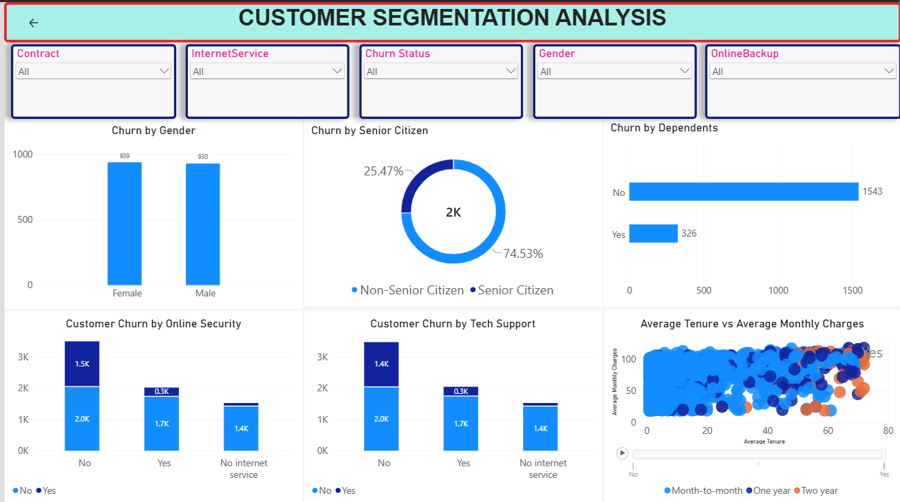

**📊 Customer Churn Analysis Dashboard | Power BI

**📌 Project Overview**

The Customer Churn Analysis Dashboard is an interactive business intelligence project developed using Microsoft Power BI. This project focuses on analyzing customer churn behavior, customer demographics, service subscriptions, contract types, payment methods, and customer tenure to identify factors influencing customer retention.

The objective is to transform customer data into meaningful business insights and help organizations understand customer attrition.

**Project Objectives**

- Analyze overall customer churn and retention.
- Identify customers who are likely to leave.
- Understand churn patterns based on customer demographics.
- Analyze the impact of contract types on customer churn.
- Evaluate customer tenure and monthly charges.
- Identify service-related factors influencing churn.
- Support customer retention strategies through data-driven insights.

**Tools & Technologies**

- Microsoft Power BI
- Power Query
- DAX (Data Analysis Expressions)
- Microsoft Excel
- Data Modeling
- Data Visualization

**📈 Dashboard Features**

- Customer Churn Analysis
- Customer Retention Analysis
- Churn Rate Analysis
- Gender-wise Churn Analysis
- Contract-wise Churn Analysis
- Internet Service Analysis
- Payment Method Analysis
- Customer Tenure Analysis
- Monthly Charges Analysis
- Interactive Slicers and Filters

**📊 Key Performance Indicators**

- Total Customers
- Churned Customers
- Retained Customers
- Customer Churn Rate
- Customer Retention Rate
- Average Monthly Charges

**🚀 How to Run the Project**

1. Download or clone the GitHub repository.
2. Open the `.pbix` file using Microsoft Power BI Desktop.
3. Update the Excel source file path if required.
4. Refresh the dataset.
5. Explore the interactive customer churn dashboard.

**Key Learnings**

- Data cleaning and transformation using Power Query.
- Data modeling and relationship management.
- Creating calculated measures using DAX.
- Analyzing customer churn and retention patterns.
- Designing interactive dashboards.
- Identifying business insights from customer data.

**Dashboard Preview**

**1. Customer Churn Analysis**

**2. Customer Segmentation Analysis**

**👨‍💻 Author**

**Suresh Kumar A**

